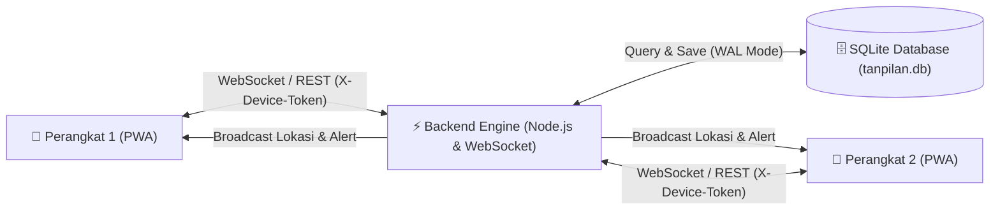

# 📍 Aplikasi Tanpilan: Pelacak Lokasi Pasangan Realtime

Aplikasi web progresif (PWA) dan backend pelacakan lokasi realtime antar-dua orang/perangkat dengan estetika *warm cartography* (peta lipat kertas & terakota pekat), didukung enkripsi modern, proteksi anti-stalkerware, dan kepatuhan privasi ketat.

---

## 🎯 Gambaran Umum & Fitur Utama

- **Antarmuka Utama (PWA)**: Web app responsif, ramah sentuh seluler (target sentuh ≥44px), dapat diinstal ke Layar Utama (*Add to Home Screen*) tanpa bar browser.
- **Pairing 1:1 Timbal-Balik (Mutual Pairing)**: Hubungan antar-perangkat diverifikasi secara timbal balik (`A.partner === B` dan `B.partner === A`). Menghubungkan perangkat baru otomatis memutuskan akses perangkat lama secara permanen.
- **Pelacakan GPS Realtime**: Transmisi koordinat GPS setiap **10 detik** via WebSocket bi-directional streaming dengan latensi pembaruan < 50 ms.
- **Peringatan Jarak Otomatis**: Perhitungan jarak geodesik Haversine memicu alert otomatis saat jarak melebihi ambang batas.
- **Geofencing Cerdas (Tempat Favorit)**: Deteksi otomatis saat pasangan tiba di rumah, kantor, atau tempat favorit lainnya.
- **Proteksi Anti-Stalkerware & Privasi**:
  - Indikator berbagi lokasi persisten yang selalu terlihat di layar perangkat yang dilacak.
  - Tombol **Jeda Berbagi Lokasi** untuk menghentikan pembaruan ke pasangan secara instan kapan saja.
  - Tombol **Putuskan Hubungan (Unpair)** yang langsung memutus akses pasangan ke lokasi dan riwayat lama.
  - Fitur **Hapus Semua Data Saya (GDPR)** untuk pembersihan permanen akun, perangkat, tempat favorit, dan titik koordinat dari database.
- **Keamanan Siber Tingkat Lanjut**:
  - Token perangkat dihasilkan oleh server menggunakan `crypto.randomBytes(32)` dan disimpan dalam bentuk hash SHA-256.
  - Proteksi Stored XSS dengan sanitasi karakter kontrol dan Subresource Integrity (SRI) pada seluruh skrip CDN.
  - Content Security Policy (CSP) ketat via `helmet`.
  - Rate limiting pada endpoint pairing (maksimal 5 percobaan/menit dengan lockout 15 menit).
  - Masa kedaluwarsa kode pairing 15 menit menggunakan epoch timestamp konsisten.
  - Retensi data otomatis 30 hari (*auto-cleanup*) terjadwal saat server mulai dan setiap 12 jam.

---

## 🏗️ Arsitektur Sistem



---

## 📁 Struktur Direktori

```
aplikasi-tanpilan/
├── backend/                       # Server Node.js + WebSocket + SQLite
│   ├── public/                    # Frontend Web App (PWA) Tanpilan
│   │   ├── index.html             # Antarmuka PWA (Peta Leaflet, HUD, Sheet, Modal)
│   │   ├── manifest.json          # PWA Web App Manifest
│   │   └── assets/                # Vektor ikon SVG mandiri
│   ├── src/
│   │   ├── config.js              # Konfigurasi aplikasi & environment
│   │   ├── index.js               # Express & HTTP/WS server entrypoint
│   │   ├── db/
│   │   │   └── database.js        # Engine database SQLite (node:sqlite) & helpers
│   │   ├── routes/
│   │   │   ├── authRoutes.js      # Auth, logout & hapus data
│   │   │   ├── deviceRoutes.js    # Registrasi device, pairing, pause & unpair
│   │   │   ├── locationRoutes.js  # Lokasi realtime, riwayat & ringkasan harian
│   │   │   └── placeRoutes.js     # Tempat favorit & geofencing
│   │   ├── services/
│   │   │   ├── trackingService.js # Pipeline pemrosesan koordinat GPS
│   │   │   └── notificationService.js # Pemicu notifikasi & peringatan jarak
│   │   ├── utils/
│   │   │   ├── geo.js             # Haversine distance & formatting
│   │   │   ├── security.js        # Bcrypt, JWT, auth middleware & pair rate limiter
│   │   │   └── validators.js      # Modul sanitasi & validasi input terpusat
│   │   └── websocket/
│   │       └── wsServer.js        # WebSocket streaming & heartbeat 30 detik
│   ├── tests/
│   │   ├── backend.test.js        # Pengujian unit geodesi, password & pairing
│   │   ├── features.test.js       # Pengujian geofencing & ringkasan harian
│   │   ├── security.test.js       # Pengujian 9 vektor keamanan & privasi
│   │   └── bug_hunt.test.js       # Audit otomatis DOM, REST API & WebSocket stress
│   ├── package.json
│   └── Dockerfile
│
├── mobile/                        # [DEPRECATED / ARSIP] Prototype React Native / Expo
│                                  # (Disimpan sebagai referensi; klien produksi utama adalah PWA)
│
├── simulator/                     # Simulator Desktop Dual-Device
│   ├── DualDeviceSimulator.html   # Simulasi visual side-by-side Wanita & Pria
│   └── run-demo.js                # CLI live interactive demo runner
│
├── data/                          # Direktori persistensi database SQLite (Docker volume)
├── docker-compose.yml             # Konfigurasi container Docker production
├── JALANKAN_APLIKASI.bat          # Launcher 1-klik untuk Windows
├── .env.example                   # Contoh konfigurasi environment variable
├── .gitignore
├── package.json                   # Root package runner
└── README.md
```

---

## 💻 Kebutuhan Sistem

- **Node.js**: Versi **≥ 22.5.0** (Wajib, karena modul bawaan `node:sqlite` membutuhkan Node.js v22.5.0 atau lebih baru).
- **NPM**: Versi ≥ 10.0.0.
- **OS**: Windows, macOS, atau Linux.

---

## 🚀 Panduan Menjalankan

### 1. Menjalankan Pengujian Otomatis

Jalankan seluruh rangkaian pengujian unit, integrasi, keamanan, dan audit DOM:
```bash
npm test
```
*Atau dari folder `backend`:*
```bash
cd backend
npm test
```

Rangkaian pengujian mencakup:
1. `backend.test.js`: Formula Geodesic Haversine, Bcrypt Hashing, Registrasi & Pairing UC-01, GPS Tracking UC-02.
2. `features.test.js`: Geofencing Tempat Favorit, Filter Spike GPS & Akurasi, Konsistensi Ringkasan Harian.
3. `security.test.js`: Token acak server, penolakan pembajakan token antar-user, sanitasi Stored XSS, perbaikan kedaluwarsa pairing, rate limiting 5x/menit, mutual pairing 1:1, ringkasan >100 titik, clamping input, jeda berbagi & penghapusan akun GDPR.
4. `bug_hunt.test.js`: Verifikasi 100% ID DOM, onclick handler, validasi REST API edge cases, WebSocket stress & malformed JSON.

### 2. Menjalankan Server Lokal

Dari direktori root:
```bash
npm start
```
Atau klik ganda berkas **`JALANKAN_APLIKASI.bat`** (khusus Windows).

Aplikasi aktif di:
- **Aplikasi Web PWA (HP / Browser)**: [http://localhost:3000/](http://localhost:3000/)
- **Simulator Dual-Device Desktop**: [http://localhost:3000/simulator/DualDeviceSimulator.html](http://localhost:3000/simulator/DualDeviceSimulator.html)
- **REST API Endpoint**: [http://localhost:3000/api](http://localhost:3000/api)
- **WebSocket Server**: `ws://localhost:3000/ws`

### 3. Menjalankan dengan Docker

Database disimpan secara persisten di volume `./data`:
```bash
docker compose up --build -d
```
Untuk menghentikan container:
```bash
docker compose down
```

### 4. Mengakses dari Jaringan Publik / Internet (Tunneling)

Berkas biner `ngrok.exe` dan `cloudflared.exe` sengaja tidak disertakan di dalam repositori git demi keamanan dan kebersihan repositori (115 MB).

Untuk membuka akses internet bagi HP pasangan:
1. Unduh ngrok resmi dari [ngrok.com/download](https://ngrok.com/download) dan pastikan perintah `ngrok` terdaftar di PATH sistem.
2. Atur environment variable `NGROK_DOMAIN` di file `.env` jika memiliki domain statis gratis:
   ```env
   NGROK_DOMAIN=domain-anda.ngrok-free.app
   ```
3. Jalankan `JALANKAN_APLIKASI.bat` atau jalankan manual di terminal:
   ```bash
   ngrok http 3000
   ```

---

## ⚙️ Variabel Lingkungan (Environment Variables)

Salin berkas `.env.example` menjadi `.env` di root atau folder `backend`:

| Variabel | Tipe | Nilai Default | Keterangan |
|---|---|---|---|
| `PORT` | Number | `3000` | Port listen server HTTP & WebSocket |
| `HOST` | String | `0.0.0.0` | Bind host interface |
| `NODE_ENV` | String | `development` | Mode aplikasi (`production` / `development`) |
| `JWT_SECRET` | String | *Auto-generated di dev* | Kunci enkripsi token JWT (Wajib diisi di production) |
| `DATABASE_PATH` | String | `./data/tanpilan.db` | Path berkas database SQLite |
| `TIMEZONE_OFFSET_HOURS` | Number | `7` | Selisih jam zona waktu (7 untuk WIB, 8 untuk WITA, 9 untuk WIT) |
| `GPS_INTERVAL_SECONDS` | Number | `10` | Interval pengiriman koordinat GPS background |
| `DISTANCE_ALERT_THRESHOLD_METERS` | Number | `100` | Jarak pemicu peringatan jarak antar-perangkat |
| `MAX_HISTORY_DAYS` | Number | `30` | Kebijakan retensi data lokasi sebelum dibersihkan otomatis |
| `GPS_MAX_ACCURACY_THRESHOLD_METERS`| Number | `50` | Titik GPS dengan radius akurasi > 50m diabaikan dari ringkasan |
| `GPS_MAX_SPEED_THRESHOLD_MPS` | Number | `40` | Kecepatan maksimal terimplikasi (40 m/s = 144 km/jam) |

---

## 🔒 Catatan Keamanan & Hak Privasi

Aplikasi pelacak lokasi memiliki risiko tinggi terhadap kebocoran informasi sensitif. Proyek ini menerapkan prinsip *Privacy by Design*:
1. **Consent Dua Arah**: Pengguna selalu mendapatkan notifikasi visual saat lokasinya sedang dilacak oleh pasangan.
2. **Kendali Penuh**: Pengguna dapat menjeda transmisi koordinat kapan saja dengan satu sentuhan tanpa harus mematikan koneksi data seluler.
3. **Pemberhentian Akses Seketika**: Melakukan *unpair* seketika mencabut hak akses pasangan terhadap seluruh riwayat posisi masa lalu.
4. **Data Minimization & Auto-Cleanup**: Titik koordinat yang berumur lebih dari 30 hari otomatis dihapus secara permanen dari server.
5. **Zero Hardcoded Secrets**: Tidak ada kata sandi atau kunci rahasia yang disimpan statis di kode sumber repositori.
